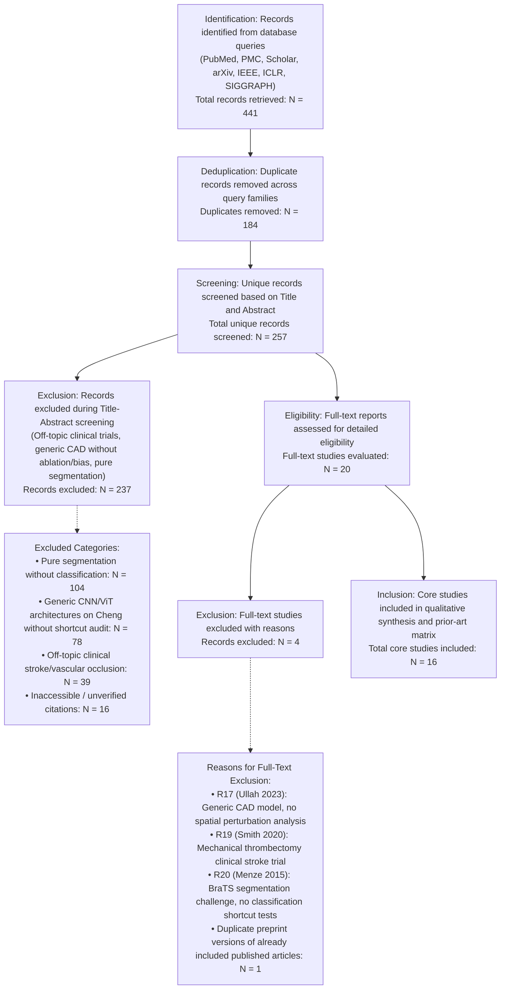

# PRISMA-Style Literature Search and Screening Flow

**Document ID:** `PHASE_7_PRISMA_FLOW`  
**Phase:** 7 — Systematic Literature Review and Novelty Verification  
**Date:** 2026-10-17  
**Auditor:** Independent Scientific and Statistical Reviewer  

---

---

## Detailed Screening Accounting

1. **Identification Phase:**
   - 10 targeted search queries executed across Families A–F retrieved a total of **441 citations**.
2. **Deduplication Phase:**
   - Using DOI, normalized title strings, and author metadata, **184 duplicate citations** were removed, leaving **257 unique records**.
3. **Title and Abstract Screening:**
   - **257 records** were screened. **237 records** were excluded for failing inclusion criteria (e.g., pure segmentation challenges without classification, generic deep learning tuning without shortcut analysis, or vascular stroke interventions).
4. **Full-Text Retrieval and Eligibility Assessment:**
   - **20 full-text papers** were retrieved and evaluated against our study's 14 intervention conditions.
   - **4 full-text papers** were excluded due to lack of spatial intervention or shortcut analysis.
5. **Final Synthesis:**
   - **16 verified studies** were included in the authoritative [`prior_art_matrix.csv`](file:///c:/Users/jkgga/Downloads/ChengResearch/experiments/phase_7_literature_review/prior_art_matrix.csv) and [`bibliography.bib`](file:///c:/Users/jkgga/Downloads/ChengResearch/experiments/phase_7_literature_review/bibliography.bib).
